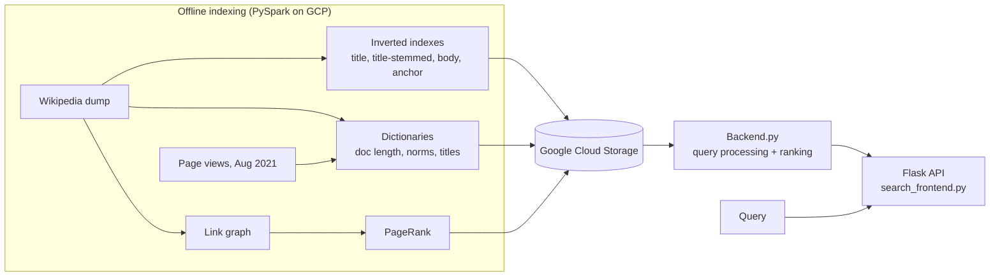

# Wikipedia Search Engine

A full-text search engine over English Wikipedia, built for the Information Retrieval course at Ben-Gurion University. It indexes article titles, bodies and anchor text, and serves ranked results through a Flask API backed by Google Cloud Storage.

## Architecture



## How it works

**Indexing (offline, `Setup Data/`).** PySpark notebooks build four inverted indexes (title with and without stemming, body, anchor text), per-document length and norm dictionaries, a PageRank score from the Wikipedia link graph, and page-view counts. Posting lists are written as binary files to a GCS bucket.

**Query time (`Search Engine/`).** A query is tokenized (with and without Porter stemming). Posting lists for each token are read from GCS in parallel threads. Each field is scored separately:

- Body: BM25 and cosine similarity over tf-idf
- Title: binary (term-presence) matching, with and without stemming
- Anchor text: term-count scoring

Field scores are combined with weights, then boosted by PageRank and page views. The weights change when the query looks like a question (`split_weights`). Four variants of the combination are implemented in `backend_search_V1` to `V4`; the main `/search` endpoint uses V1.

## Endpoints

| Endpoint | Returns |
|---|---|
| `GET /search?query=...` | Combined ranking over title, body and anchor, boosted by PageRank and page views |
| `GET /search_body?query=...` | Body only, cosine similarity over tf-idf |
| `GET /search_title?query=...` | Title only, binary term matching |
| `GET /search_anchor?query=...` | Anchor text only |
| `POST /get_pagerank` | PageRank values for a JSON list of article ids |
| `POST /get_pageview` | Page-view counts (August 2021) for a JSON list of article ids |

## Running

The full index is several GB and lives in GCS, so running the engine needs your own bucket.

1. Build the indexes with the notebooks in `Setup Data/` (run in order: Dictionaries, Inverted Index, Graph, Page Rank, Page View).
2. Copy `.env.example` to `.env` and set `GCP_PROJECT_ID` and `GCS_BUCKET`.
3. Install and run:

```bash
pip install -r requirements.txt
python "Search Engine/search_frontend.py"
```

## Project structure

```
Search Engine/
  search_frontend.py      Flask API, loads indexes and dictionaries
  Backend.py              tokenization, scoring, ranking variants
  inverted_index_gcp.py   inverted index read/write on GCS
Setup Data/               PySpark notebooks that build indexes and dictionaries
```

## Team

Built as a pair project for the Information Retrieval course; we designed and implemented the indexing pipeline and the retrieval engine together.

## Limitations

- Requires GCP; there is no small local demo yet.
- Ranking weights were tuned by hand on the course query set.

## Tech stack

Python · PySpark · Flask · Google Cloud Storage · NLTK
